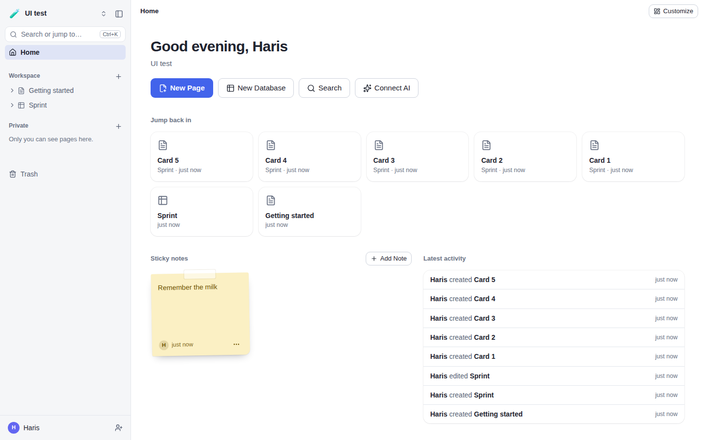
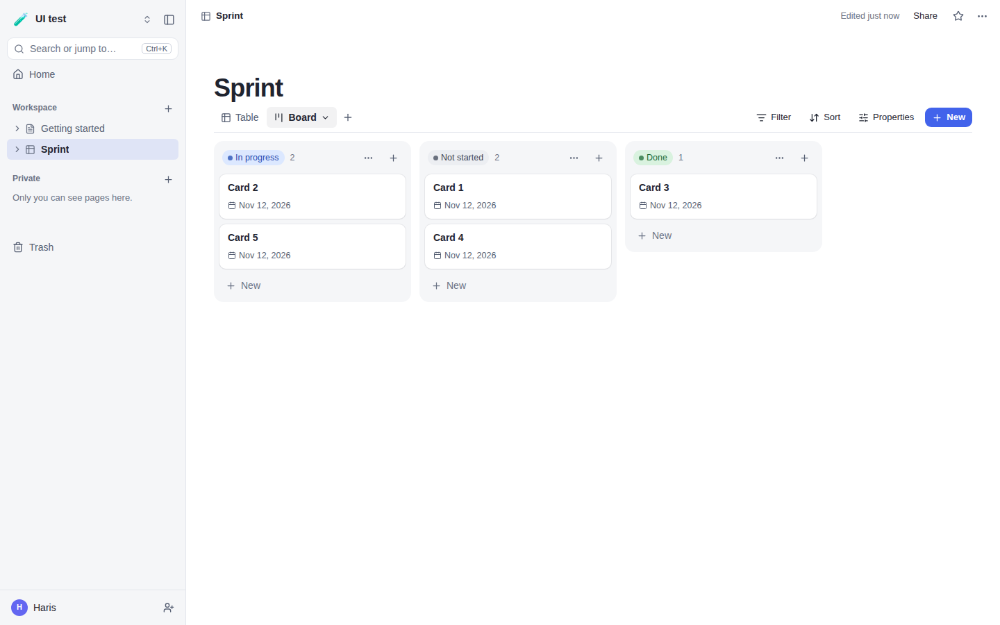
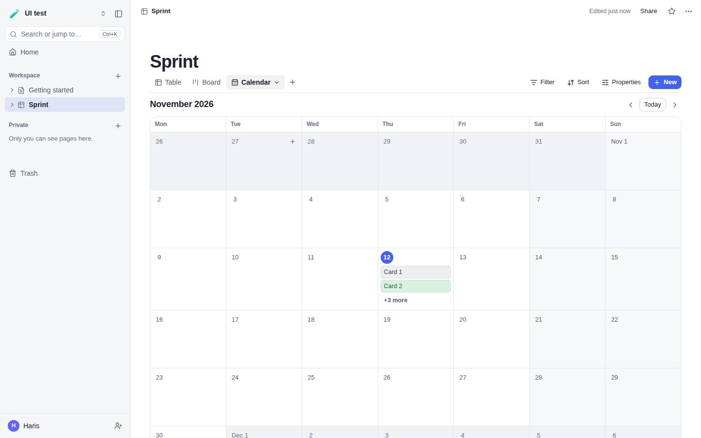
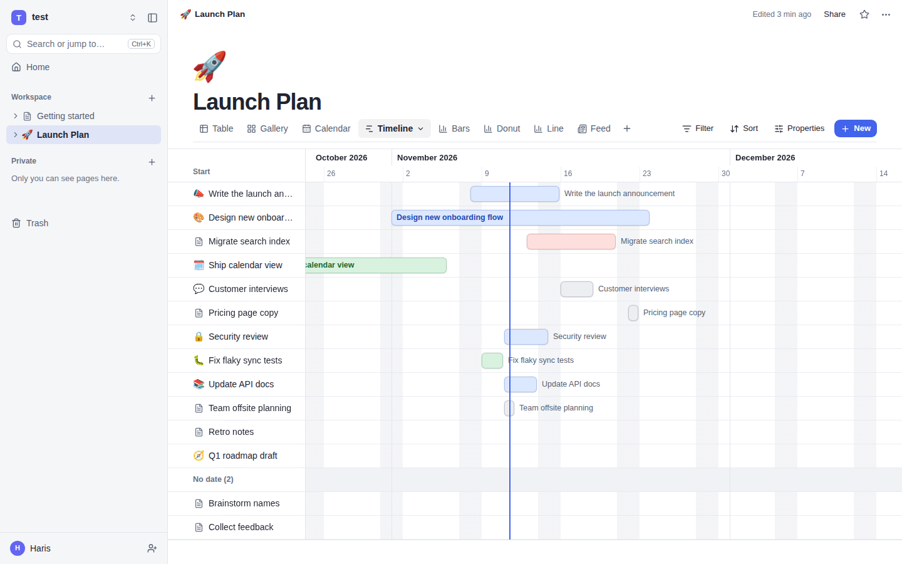
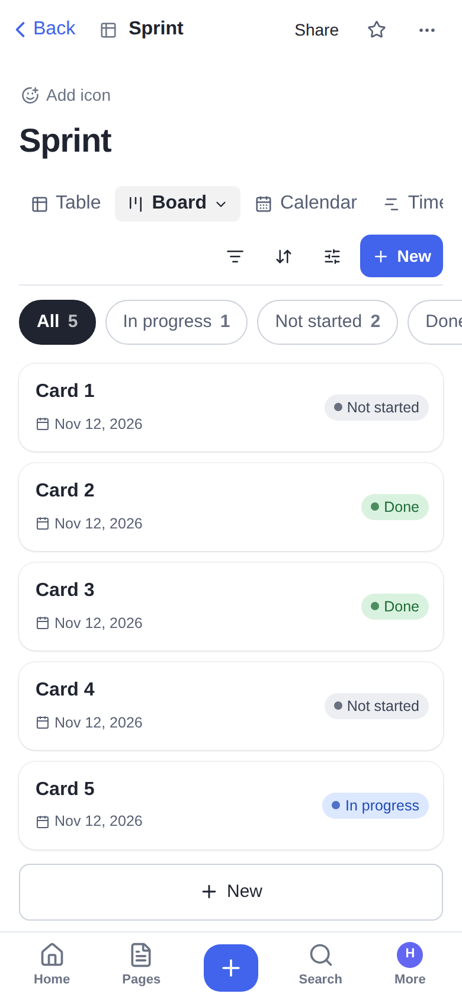

<p></p>

**Cairn** is a self-hosted workspace for notes, docs and databases that is easy to find your way
around, with a built-in MCP server so AI agents work in the same pages you do. Think Notion or
AppFlowy, in one small container you own.



| Board | Calendar | Timeline | Phone |
| --- | --- | --- | --- |
|  |  |  |  |

## What it does

- **Pages** that nest, with a block editor: headings, to-dos, lists, callouts, code, images (paste or drop a screenshot), page links. `/` for blocks, `@` to link a page.
- **Databases** where every row is a page, with eight views: table, board, list, gallery, calendar, timeline, chart and feed. Filters, sorts, typed properties, relations, movable board columns, per-view card fields.
- **A home page you arrange**: widgets for recent pages, favourites, activity, embedded database views, pages, notes, quick links, upcoming dates, stats and a **sticky-note wall**. One layout for the workspace, or your own.
- **Made for phones too**: a tab bar, boards and tables as swipeable card lists, calendars as an agenda, menus as bottom sheets. Installs to the home screen.
- **Workspaces and people**: many workspaces per account, four roles, invite links, private pages.
- **Wayfinding**: breadcrumbs everywhere, favourites, search and commands on ⌘K / Ctrl+K, trash with undo, version history.
- **AI built in**: an MCP endpoint at `/mcp` with 34 tools and OAuth sign-in. Agent edits are labelled, logged and versioned.
- **Your data moves freely**: import Markdown, CSV, Notion exports or straight from the Notion API; export a workspace as Markdown + CSV + JSON, or push pages and databases back to Notion.
- **Calendars**: subscribe to Cairn's dates from Google, Apple or Outlook calendars, and show outside calendars (any iCal address) inside Cairn.
- **Backups**: scheduled, to the server, Nextcloud/WebDAV, or Google Drive, Dropbox, OneDrive, S3 and more through rclone.
- **Administration**: people, workspaces, sign-up policy, usage, backups; light, dark and six accent colours per person.

## Run it

```bash
git clone https://github.com/harisbashir/cairn && cd cairn
docker compose up -d --build      # serves on port 80; data lives in the cairn-data volume
```

Open it and create the first account, which becomes the administrator.

| Setting | Default | Meaning |
| --- | --- | --- |
| `CAIRN_BIND` | `0.0.0.0:80` | Host address and port to publish |
| `CAIRN_PUBLIC_URL` | from the request | The address people use; needed for invite, share, calendar and OAuth links behind a proxy |
| `CAIRN_SECURE_COOKIES` | off | Set to `1` when Cairn is only reached over HTTPS |
| `CAIRN_MAX_STORAGE_MB` | unlimited | Upload quota per workspace |
| `CAIRN_CORS_ORIGINS` | none | Origins allowed to call the API from a browser |

Put it behind HTTPS (Caddy, nginx, Tailscale Serve, Cloudflare Tunnel) before using it outside your network.

### Admin commands

```bash
docker compose exec cairn node dist/server/src/cli.js create-user --email a@b.c --name "Ada" --password "…" --admin
docker compose exec cairn node dist/server/src/cli.js reset-password --email a@b.c --password "…"
docker compose exec cairn node dist/server/src/cli.js backup --out /data/backups/manual.zip
docker compose exec cairn node dist/server/src/cli.js restore /data/backups/<file>.zip
```

## Connect an AI client

Clients that support OAuth (claude.ai connectors, ChatGPT, recent desktop apps): add the server
URL `https://your-host/mcp` and sign in when asked. Clients that take a header: create a token in
**Settings → AI & MCP**, then for example:

```bash
claude mcp add --transport http cairn https://your-host/mcp --header "Authorization: Bearer cairn_..."
```

Tokens can be read-only and limited to one workspace.

## Build on it

- REST API under `/api/v1`, described by `GET /api/openapi.json`. Bearer tokens or OAuth 2.1 + PKCE.
- [`docs/MOBILE.md`](docs/MOBILE.md): how to build iOS and Android apps against it.
- [`docs/SPEC.md`](docs/SPEC.md) and [`docs/SPEC-0.2.md`](docs/SPEC-0.2.md): the API and MCP contract. [`shared/types.ts`](shared/types.ts): every request and response shape.
- [`docs/DESIGN.md`](docs/DESIGN.md): the interface rules.

## Develop

```bash
npm install
npm run dev:server   # API on :8080 (data in ./data)
npm run dev:web      # web on :5173, proxied to the API
npm test && npm run typecheck
```

Stack: Node 24, TypeScript, Hono, the built-in `node:sqlite`, React, Tiptap, Vite. One process, one SQLite file.

## Roadmap

Real-time co-editing, comments and mentions, email (invites, password reset, digests), push
notifications and native mobile apps, two-way Google Calendar sync, templates, per-page
permissions, SSO, a Postgres option.

## Licence

[AGPL-3.0-or-later](LICENSE). You can run and modify Cairn freely; if you offer a modified version
as a service, you share your changes.
